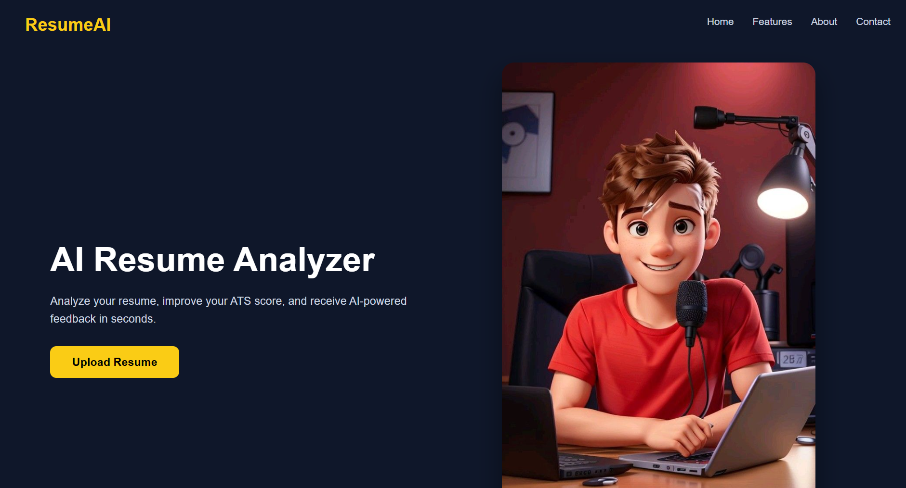
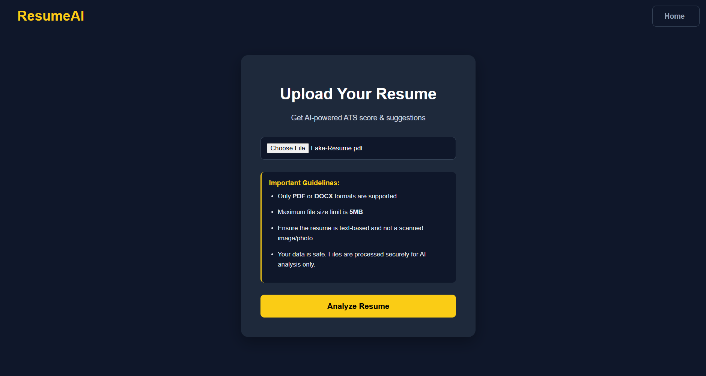
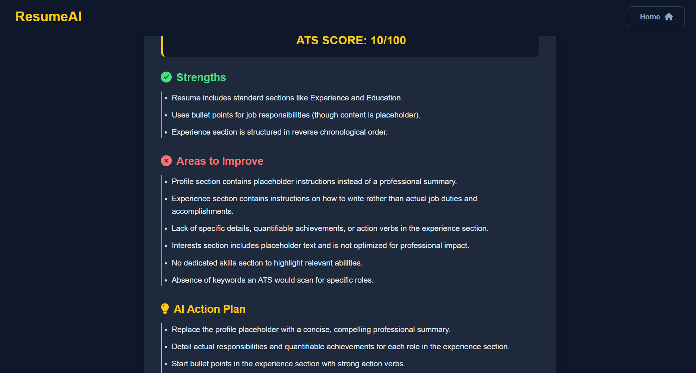

# 🤖 AI Resume Analyzer

An AI-powered Resume Analyzer that evaluates resumes using Google's Gemini AI and provides ATS score, strengths, weaknesses, and improvement suggestions.

The application helps job seekers optimize their resumes and improve their chances of passing Applicant Tracking Systems (ATS).

---

## 🚀 Live Demo

🔗 Live Website:
https://ai-resume-analyzer-vx7n.onrender.com

---

## 📌 Features

### 📄 Resume Upload
- Upload resume in PDF format.
- Extracts resume content automatically.

### 🤖 AI Resume Analysis
- Uses Google Gemini AI for intelligent resume evaluation.
- Generates structured analysis in JSON format.

### 📊 ATS Score
- Provides ATS compatibility score out of 100.

### 💡 Improvement Suggestions
- Identifies resume strengths.
- Highlights weaknesses.
- Suggests improvements.

### 🎯 User Friendly Interface
- Modern dark theme UI.
- Responsive design.
- Simple upload workflow.

---

## 🛠️ Tech Stack

### Backend
- Python
- Django
- Google Gemini API
- PyPDF2

### Frontend
- HTML
- CSS
- Django Templates

### Deployment
- Render
- Gunicorn
- WhiteNoise

### Database
- SQLite

---

## ⚙️ How It Works

1. User uploads a resume PDF.
2. Application extracts text from the PDF.
3. Extracted content is sent to Gemini AI.
4. AI analyzes resume based on ATS parameters.
5. User receives score and improvement suggestions.

---

## 📂 Project Structure
AI-Resume-Analyzer

│
├── analyzer
│ ├── views.py
│ ├── urls.py
│
├── resume_analyzer
│ ├── settings.py
│ ├── urls.py
│
├── templates
│
├── static
│
├── manage.py
├── requirements.txt
└── README.md

GitHub:
https://github.com/Aaniket136

## 📸 Screenshots

### Home Page

### Upload Resume

### AI Analysis Result

